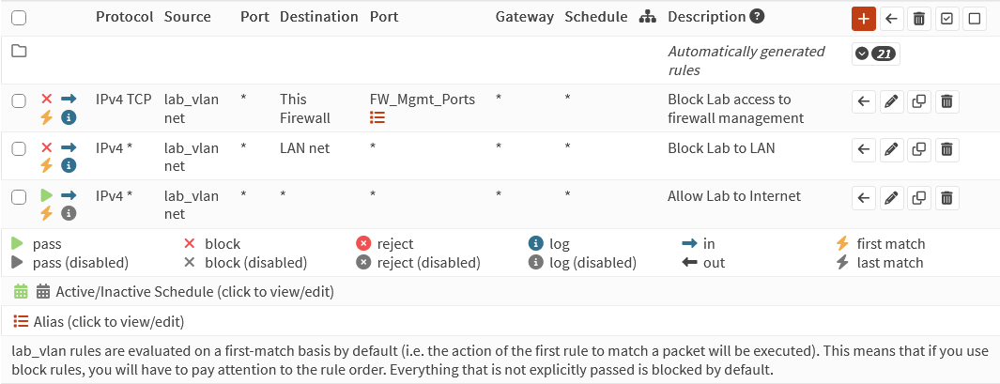

:::caution[Work in progress]
Some sections are still being written.
:::

## Goal

Build a segmented home network with a real firewall in front of it, so lab
experiments stay isolated from my trusted devices and my DNS traffic is
private.

## Design

| Network | VLAN     | Subnet            | Purpose                           |
|---------|----------|-------------------|-----------------------------------|
| LAN     | untagged | `192.168.1.0/24`  | Trusted clients and management    |
| Lab     | 10       | `192.168.10.0/24` | GNS3, lab VMs, auxiliary services |

Notable hosts:

| Host          | Network | Role                         |
|---------------|---------|------------------------------|
| OPNsense      | Both    | Gateway / firewall           |
| Proxmox VE    | Lab     | Hypervisor for lab VMs       |
| Storage host  | Lab     | SMB file shares              |

```text
             Internet
                 |
            [ OPNsense ]
             /        \
         LAN          Lab (VLAN 10)
 192.168.1.0/24       192.168.10.0/24
```

:::note[Why segment?]
Anything I break or test in the lab can't reach my personal devices
unless a firewall rule explicitly allows it. This is the same idea as
separating enclaves in an enterprise network.
:::

## Firewall

The policy in one line: **the LAN can start connections into the Lab, but
the Lab can't start connections into the LAN.**

OPNsense is a stateful firewall, so rules only apply to whoever *starts* a
connection. When I SSH from my PC into a lab VM, the replies come back
automatically. When a lab VM tries to open a connection to my PC, it's
dropped.

### Lab rules

Evaluated top-down, first match wins:

| # | Action | Source | Destination | Ports | Why |
|---|---|---|---|---|---|
| 1 | Block | Lab net | This Firewall | 22, 80, 443 | Lab can't reach the firewall's SSH or web GUI on any of its addresses |
| 2 | Block | Lab net | LAN net | any | Lab can't reach trusted devices |
| 3 | Pass | Lab net | any | any | Everything else: internet, plus DNS/DHCP/NTP from the Lab gateway |

Ports 22, 80 and 443 live in a port alias (`FW_Mgmt_Ports`) so the rule
stays readable. Rule 1 comes from
[patching OPNsense for PHP2Shell](/homelab/opnsense-php2shell-patch/).



### Verify the isolation

Tested from a Kali VM on the Lab network, before and after adding rule 2:

| Test from Kali (Lab) | Before | After |
|---|---|---|
| `ping 192.168.1.1` (firewall's LAN address) | Replies | **100% loss** |
| `nslookup example.com 192.168.1.1` | Resolves | **Timed out** |
| `ping 192.168.10.1` (Lab gateway) | Replies | Replies |
| `nslookup example.com` (via Lab gateway) | Resolves | Resolves |

The two tests that should fail now fail, and the two that should keep
working still work: the Lab lost access to the LAN, not to its own gateway.
I ran all of this over an SSH session from my PC into Kali, and that session
stayed up the whole time, which shows LAN → Lab still works.

## Encrypted DNS (DNS-over-TLS)

**Why:** normal DNS (port 53) is plaintext, so my ISP or anyone on the path
can see, log, or tamper with every domain I look up. DNS-over-TLS wraps those
queries in TLS on port 853.

### Setup

In OPNsense (menu names may vary slightly by version):

1. **Services → Unbound DNS → General**: enable Unbound and
   **Enable DNSSEC Support**.
2. **Services → Unbound DNS → DNS over TLS**: add Cloudflare upstreams:

    | Server     | Port | Verify CN            |
    |------------|------|----------------------|
    | `1.1.1.1`  | 853  | `cloudflare-dns.com` |
    | `1.0.0.1`  | 853  | `cloudflare-dns.com` |

3. TODO: anything else I changed (e.g. System → Settings → General DNS
   servers, "allow DNS override" unchecked).

### Verify

- Visit <https://1.1.1.1/help>. It should show
  **Using DNS over TLS (DoT): Yes**.
- From a LAN client:

    ```bash
    nslookup example.com     # server should be the OPNsense IP
    ```

## Lessons

### My documentation said the Lab was isolated, and it wasn't

This page originally said the Lab was blocked from the LAN. When I actually
tested from Kali, it could reach everything. The Lab interface had a
pass-everything rule that looked like a copy of the LAN's default rule, and
nothing above it to block the LAN.

Two things fixed it: a block rule, and a test from the untrusted side. The
second one matters more. A firewall policy isn't real until you've tried to
break it from the network it's supposed to contain.

## Next steps

- [ ] Block outbound port 53 from clients so devices can't bypass Unbound
- [ ] Move hypervisor management to its own network, separate from lab VMs
