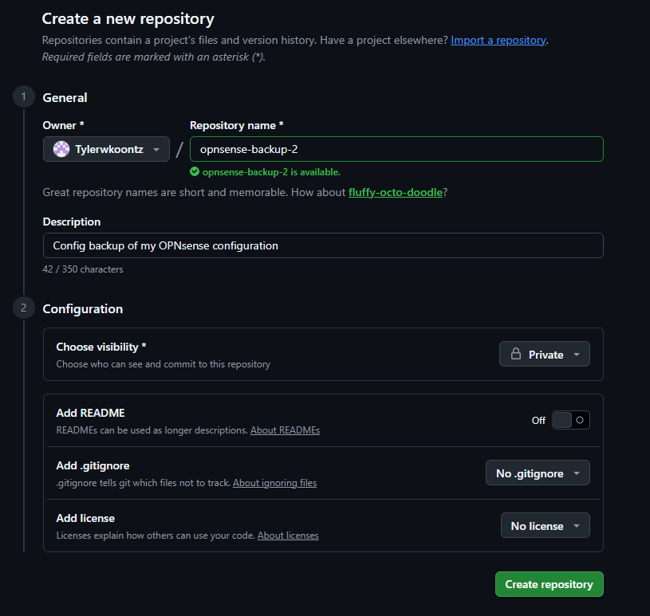
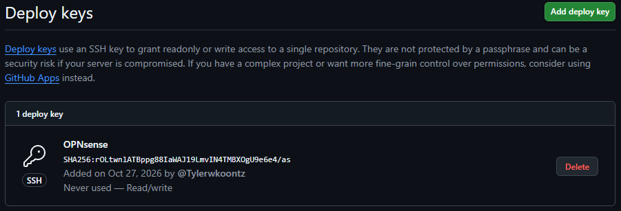
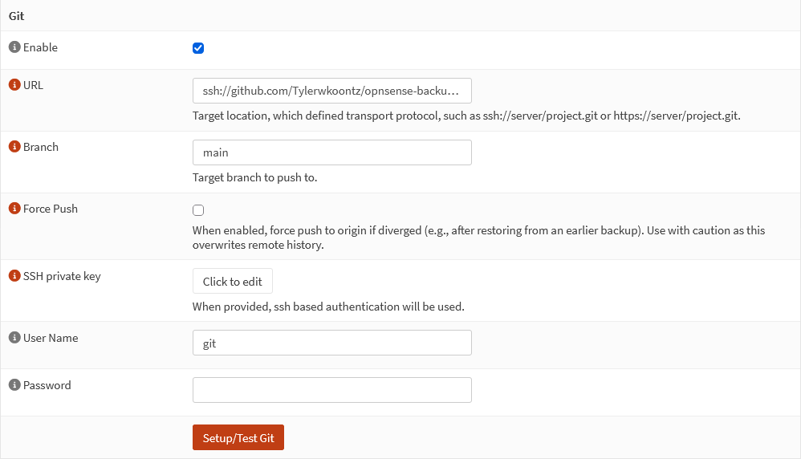
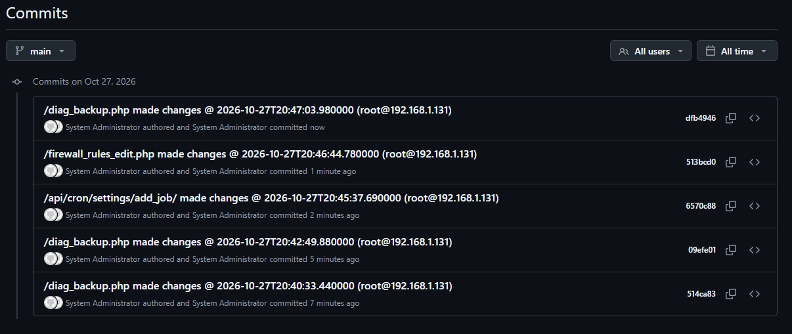
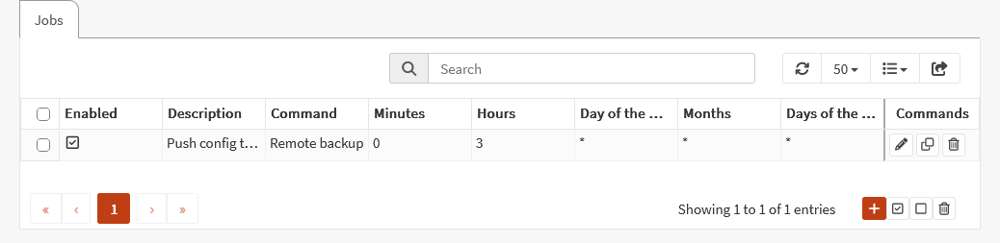
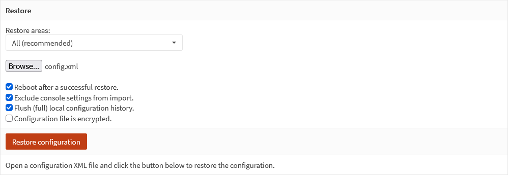

| | |
|---|---|
| **Problem** | My firewall's whole configuration lived in one place: the firewall |
| **Approach** | Record every config change as a Git commit and push it to a private repo |
| **Outcome** | A versioned history of every change, restorable at any time |

## Goal

OPNsense stores its entire configuration in a single file, `config.xml`. If
the disk dies or an update goes wrong, that file is the difference between a
10-minute restore and rebuilding from memory.

I want:

- every change **recorded automatically**, without remembering to click anything
- a **history** of what changed and when (like `git log` for my firewall)
- the backup stored **off the device**

## Why a private repo

:::danger[Never put config.xml in a public repo]
`config.xml` contains password hashes, VPN private keys, certificates,
firewall rules, and network details. It **cannot be sanitized**, because it's
the real machine state. It belongs in a **private** repo only.
:::

I keep two repos:

| Repo | Visibility | Contains |
|---|---|---|
| `opnsense-backup` | Private | Raw `config.xml`, pushed by OPNsense |
| This site | Public | Sanitized guides like this one |

## What you need

- OPNsense with web GUI access (I'm on 26.1)
- A GitHub account with **two-factor authentication enabled**
- A terminal with `ssh-keygen` (Linux, macOS, or Windows/WSL)

## Step 1: Create the private repo

On GitHub, create a new repository:

- **Name:** `opnsense-backup`
- **Visibility:** **Private**
- **Initialize:** leave everything unchecked (empty repo)



(The screenshot shows a second test name; mine is `opnsense-backup`.)

## Step 2: Install the plugin

**System → Firmware → Plugins**, search for `git-backup`, and install
**os-git-backup**.


## Step 3: Create a deploy key

A **deploy key** is an SSH key that grants access to **one repository only**.
If it ever leaks, the attacker gets this backup repo and nothing else in your
GitHub account. It's least privilege, applied to a backup job.

Generate a key pair:

```bash
ssh-keygen -t ed25519 -C "opnsense-backup" -f ~/opnsense-backup-key -N ""
```

This creates two files:

| File | Goes to |
|---|---|
| `opnsense-backup-key.pub` | GitHub (public key) |
| `opnsense-backup-key` | OPNsense (private key) |

Add the **public** key to the repo:

1. Repo → **Settings → Deploy keys → Add deploy key**
2. **Title:** `OPNsense`
3. **Key:** the output of `cat ~/opnsense-backup-key.pub`
4. Check **Allow write access** (OPNsense needs to push)



The fingerprint shown is safe to publish. It identifies the public key and
can't be used to log in. Never screenshot the private key.

## Step 4: Connect OPNsense to the repo

**System → Configuration → Backups**, in the **Git** section:

| Field | Value |
|---|---|
| Enable | ✅ |
| URL | `ssh://github.com/<your-username>/opnsense-backup.git` |
| Branch | `main` |
| Force Push | ☐ Leave unchecked |
| SSH private key | Contents of `~/opnsense-backup-key` (the file **without** `.pub`) |
| User Name | `git` |
| Password | *(empty)* |

:::caution[Two gotchas with the URL]
**1. Use a full `ssh://` URL.** GitHub shows the short form
`git@github.com:user/repo.git`, but OPNsense rejects it with *"A valid git
location must be provided."*

**2. Don't put the user in the URL.** OPNsense adds the **User Name** field
in front of the host itself. With `git@` in the URL as well, it connects as
`git@git@github.com`. With User Name left empty, it defaults to
`root@git@github.com`. Both fail with *"authentication failure"*. Put the
user only in the User Name field (`git`), and keep the URL as
`ssh://github.com/...`.
:::



**Force Push** overwrites the repo's history when it disagrees with the
firewall's. Leave it off. Its only use is after restoring an older config,
and history is the whole point of this setup.

## Step 5: Run the first backup

Click **Setup/Test Git**. On success, OPNsense pushes the config and lists
what's in the repo:


Refresh the repo on GitHub and `config.xml` is there, with its first commit.

### How the commits work

From here on, **every config change becomes its own commit**, named after
the page that made it. To test it, I edited a firewall rule's description,
then pushed:



`/firewall_rules_edit.php` is my test change. `/api/cron/settings/add_job/`
is the schedule from Step 6. Clicking a commit on GitHub shows exactly which
lines of `config.xml` changed: a `git log` and `git diff` for the firewall.

Recording and pushing are separate, though. OPNsense commits each change
locally right away, but it **doesn't push on every change**. I tested it:
after another rule edit, nothing reached GitHub in 5 minutes. Pushes happen
when you click **Setup/Test Git** or save the Git settings, and on the
schedule in Step 6.

## Troubleshooting "authentication failure"

My first attempts failed with *"authentication failure"*. That GUI message
is generic, so I narrowed it down in two steps:

1. **Test the key outside OPNsense.** From the machine where you generated
   it:

    ```bash
    ssh -i ~/opnsense-backup-key -o IdentitiesOnly=yes -T git@github.com
    ```

    *"Hi user/opnsense-backup! You've successfully authenticated"* means the
    key and deploy key are fine, and the problem is in OPNsense's settings.

2. **Read the real error** in **System → Log Files → General** (search
   `git`). Mine showed `git@git@github.com: Permission denied`, which
   pointed straight at the doubled user name (gotcha 2 above). With User
   Name empty, it showed `root@git@github.com` instead.


## Step 6: Push on a schedule

**System → Settings → Cron → +** adds a job that runs OPNsense's
**Remote backup** command, which pushes to every enabled backup target,
including Git:

| Field | Value |
|---|---|
| Minutes | `0` |
| Hours | `3` (daily at 03:00 UTC) |
| Command | Remote backup |
| Description | `Push config to Git` |

Save, then click **Apply**.



Even if I forget to push after a change, it reaches GitHub within a day.
After a bigger change, I click **Setup/Test Git** to push it right away.

## Step 7: Clean up the key

OPNsense now has the private key, so remove the copies from your machine:

```bash
rm ~/opnsense-backup-key ~/opnsense-backup-key.pub
```

Deploy keys are disposable. If you ever lose it, generate a new pair, replace
the key on GitHub, and paste the new private key into OPNsense.

## The trade-off

The plugin pushes `config.xml` **unencrypted**. A private repo keeps it away
from the public, but it's stored on GitHub's servers, and **your GitHub
account becomes the key to your firewall config**.

What I do about it:

- Two-factor authentication on GitHub (required, not optional)
- A deploy key scoped to one repo, instead of a personal access token
- A separate **encrypted** manual backup, kept offline, for disaster recovery

:::note[Future improvement]
Self-host the Git server inside the homelab so the config never leaves my
network.
:::

## Step 8: Test a restore

A backup you've never restored is only a hope, so I tested one. I
downloaded `config.xml` from the repo and restored it through **System →
Configuration → Backups → Restore**:



| Option | Setting | Why |
|---|---|---|
| Restore areas | All | Full restore, as if rebuilding the firewall |
| Reboot after a successful restore | ✅ | Applies every setting cleanly |
| Exclude console settings | ✅ | Keeps the local console settings of the box you're restoring onto |
| Flush (full) local configuration history | ✅ | Clears the firewall's change history, **including its local Git repo**. See the warning below. |
| Configuration file is encrypted | ☐ | The Git copy is plain XML (see the trade-off above) |


The firewall rebooted with the restored config and came back working. I
restored onto the same firewall, which proves the file and the process
work. Restoring onto a fresh OPNsense VM would be the stronger test, and
it's on my list.

:::caution[After a restore, Git backups stop until you force push once]
"Flush local configuration history" also wipes the firewall's local Git
repo. It starts a new history that doesn't match GitHub's, so every push
is rejected:

`git-backup git out of sync (… ! [rejected] master -> main (fetch first) …)`

The fix is the **Force Push** option from Step 4, once:

1. Check **Force Push** and click **Setup/Test Git**. GitHub's history is
   replaced with the firewall's new one.
2. **Uncheck Force Push** and save. Left on, a future mismatch would
   silently overwrite history instead of warning you.

The commits before the restore are lost from GitHub. Keep an offline
encrypted backup if that history matters to you.
:::

## Lessons

### The error message pointed the wrong way

*"Authentication failure"* sounds like a bad key, so my first instinct was to
regenerate it. The key was fine. Testing it directly against GitHub proved
that in one command, and the log showed the real problem: OPNsense was
building the SSH address from two fields, and I'd put the user in both.

The habit worth keeping: when a GUI gives a vague error, test each piece on
its own (the key, then the connection, then the settings) and find the log
that shows the actual command. It's the same approach as troubleshooting a
circuit hop by hop instead of swapping hardware.

### The restore test found what the backup test couldn't

After Step 5, everything looked done: "Backup successful," a commit on
GitHub. Testing a restore broke it. The restore wiped the firewall's local
Git history, and backups silently stopped until I force pushed.

If I'd skipped the restore test, I'd have found out during a real
emergency, with backups weeks out of date. Testing the recovery path, not
only the backup, is the part that counts.
