In October 2026, two critical PHP vulnerabilities, known as
**PHP2Shell**, were disclosed. OPNsense's web interface runs on PHP. My
firewall hadn't been updated in 65 days.

| | |
|---|---|
| **Problem** | Critical PHP flaws on the device that protects my whole network |
| **Approach** | Verify the fix is really in the update, back up, patch, verify again |
| **Outcome** | OPNsense 26.1.2_5 → 26.1.11_10, PHP 8.3.30 → 8.3.36, about 5 minutes start to finish |

## Goal

Patch my OPNsense firewall against PHP2Shell, and be able to **prove** the
vulnerable component was fixed, not just that the version number changed.

## Background: what is PHP2Shell?

PHP2Shell is the name for two flaws in PHP disclosed on October 21, 2026:

- **CVE-2026-109618**: can be chained into remote code execution as the
  web server's user.
- **CVE-2026-109619**: a stale global state issue.

The PHP project fixed both in **PHP 8.5.12, 8.4.27, 8.3.36, and 8.2.35**.

Why it matters for OPNsense: the web GUI runs on PHP. Anyone who can reach the
login page is a potential attacker. On a typical home network, that includes
every device on the inside, compromised or not.

## Step 1: Spot the problem

The OPNsense dashboard has an **Announcements** widget. That's where I first
saw the hotfix notice.

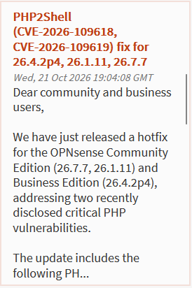

The **System Information** card showed I was well behind:

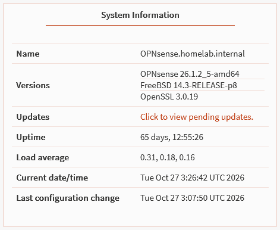

My firewall had been up for 65 days without an update. A long uptime looks nice, but it also means no patches.

## Step 2: Check what the update actually contains

**System → Firmware → Status → Check for updates** offered:

| Package | Installed | Offered |
|---|---|---|
| `opnsense` | 26.1.2_5 | 26.1.11_10 |


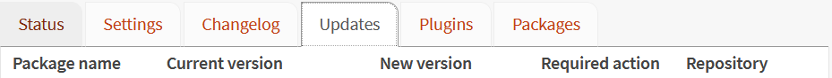


### Don't trust the version number

Here's the catch. My sources didn't agree:

- The dashboard announcement listed 26.1.11 as fixed.
- The [main OPNsense forum thread](https://forum.opnsense.org/index.php?topic=53191.0)
  only named 26.7.7 and 26.4.2p3.
- A [forum user on 26.1.11_10](https://forum.opnsense.org/index.php?topic=53192.0)
  asked whether the fix had been backported to 26.1.x.
- 26.1.11 also fixed a **different** CVE
  ([CVE-2026-58394](https://www.mend.io/vulnerability-database/CVE-2026-58394/)),
  so "26.1.11 fixes a CVE" didn't necessarily mean *this* CVE.

So I checked the component that's actually vulnerable: the **PHP package** in
the same update list.

| Package | Installed | Offered |
|---|---|---|
| `php83` | 8.3.30 | **8.3.36** ✅ |


8.3.36 is one of the fixed PHP versions. The fix was in the update.

:::note[Takeaway]
A product version number tells you what was released. A **package** version
tells you what's actually installed. When a vulnerability is in a component
(PHP, OpenSSL, the kernel), check that component.
:::

## Step 3: Back up before changing anything

**System → Configuration → Backups → Download configuration**, with
**Encrypt this configuration file** checked. OPNsense named the file with
the hostname and a UTC timestamp: `config-<hostname>-20261027053129.xml`.

If the update had broken something, this file restores every setting on a
fresh install. I keep it outside any git repo, encrypted, with the password
written down offline.

For the long term, I'm setting up automatic, version-controlled backups to a
private GitHub repo. That guide is coming soon.

## Step 4: Patch

**System → Firmware → Status → Update.** OPNsense warned up front that the
firewall would reboot as soon as the update finished:

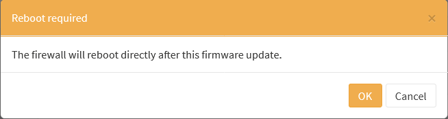

The update log scrolled through 122 package downloads. The `php83-*`
packages at **8.3.36** were in the list:

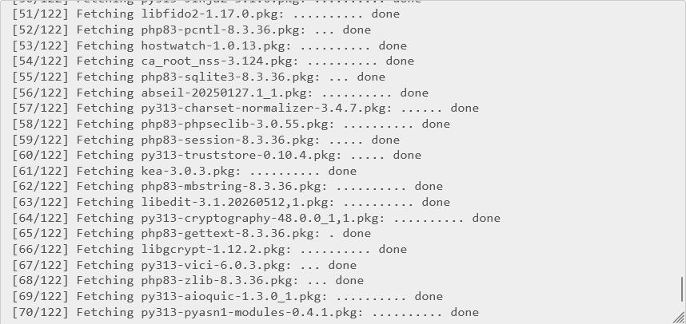

<details>
<summary>More of the update log</summary>

The package summary: 15 removed, 52 installed, 70 upgraded. Services such as
CrowdSec were stopped and restarted as their packages were replaced.

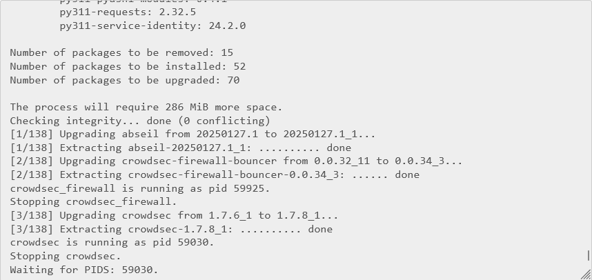

After the packages, it fetched the FreeBSD base system and kernel for 26.1.11:

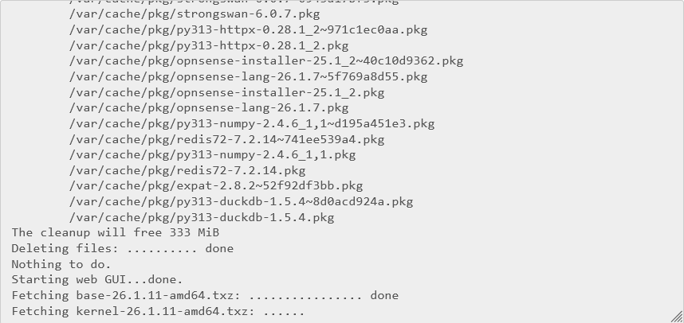

</details>

Then it rebooted on its own:

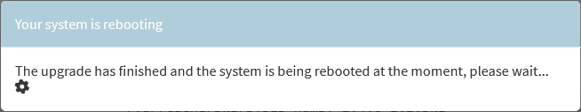

| Time (UTC) | Event |
|---|---|
| 05:31 | Encrypted backup downloaded |
| ~05:33 | Update started |
| 05:35 | Packages done, reboot started |
| 05:37 | Firewall back up |

About **5 minutes** from clicking Update to a working GUI, and roughly
**60 seconds** of actual network downtime during the reboot.

## Step 5: Verify

Patching isn't done until it's verified.

**System → Firmware → Status** after the reboot:

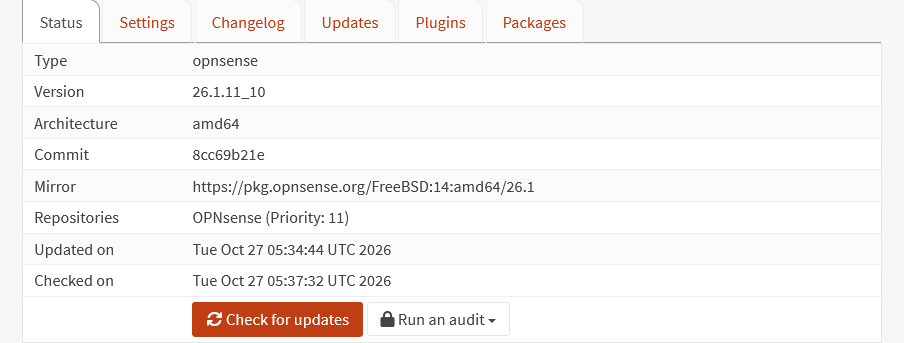

A fresh **Check for updates** confirmed nothing was left on the 26.1 branch:

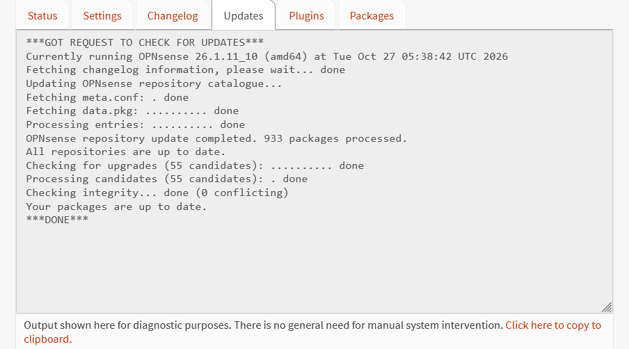

| Check | Where | Expected | Result |
|---|---|---|---|
| OPNsense version | System → Firmware → Status                   | 26.1.11_10 | ✅ 26.1.11_10 |
| Pending updates  | Check for updates                            | Up to date | ✅ Up to date |
| PHP version      | System → Firmware → Packages, search `php83` | 8.3.36     | ✅ 8.3.36     |
| Services running | Dashboard → Services widget                  | All green  | ✅            |
| DNS and internet | `nslookup example.com` from a client         | Resolves   | ✅            |

The log showed 8.3.36 being *downloaded*. The package list shows it's
actually *installed*, which is the claim this whole page rests on:

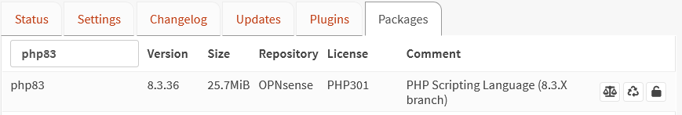

## Step 6: Reduce exposure for next time

Patching fixes *this* bug. The next one will have the same opening: any
device on my network can reach the firewall's login page, including the lab
VMs I deliberately treat as untrusted.

**System → Settings → Administration → Listen Interfaces** controls which
interfaces the GUI answers on. I changed it from all interfaces to **LAN**
only:


:::caution[Don't lock yourself out]
Make this change from a device on the **LAN**. If you do it from the Lab
network, your session drops and you lose access to the GUI from there.
:::

### The catch: "listen on LAN" isn't "only reachable from LAN"

Listen Interfaces controls which **IP address** the GUI binds to. It doesn't
control who can **route** to that address. A Lab device can no longer reach
the GUI on the Lab gateway address, but it can still try the firewall's
**LAN** address. If the Lab firewall rules allow traffic to it, the GUI is
still reachable.

So the real test is from a Lab machine, against **both** addresses:

```bash
# From a Lab VM (Kali, in my case). 000 = no connection, which is what we want.
curl -sk -o /dev/null -w '%{http_code}\n' --max-time 5 https://<lab-gateway-ip>
curl -sk -o /dev/null -w '%{http_code}\n' --max-time 5 https://<firewall-lan-ip>
```

The LAN address answered with **200**: the login page loaded from my Kali
VM on the Lab network. Listen Interfaces had moved the GUI off the Lab
address, but nothing stopped the Lab from routing to the LAN address.

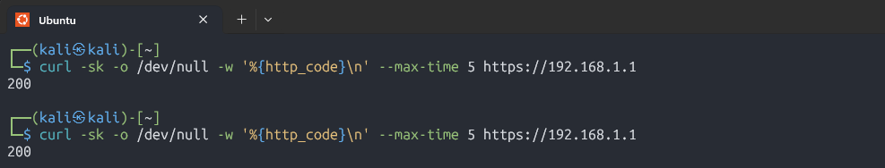

### The fix: a firewall rule, not a setting

Listen Interfaces decides where a service runs. Deciding who can reach it is
the firewall's job. I added a rule on the **Lab** interface that blocks Lab
devices from the firewall's management ports, on every firewall address:

| Field | Value |
|---|---|
| Action | Block |
| Interface | Lab |
| Protocol | TCP |
| Source | Lab net |
| Destination | This Firewall |
| Destination ports | 22, 80, 443 (SSH and the web GUI) |
| Position | Top of the Lab rules |

:::note[Why not block "This Firewall" completely?]
Lab devices still need the firewall for **DNS** (53), **DHCP** and **NTP**.
Blocking every port would break the Lab network. Only management ports
are blocked.
:::

I used a **port alias** (`FW_Mgmt_Ports` = 22, 80, 443) so the rule stays
readable and the port list lives in one place:


Then I ran the same test again from Kali:

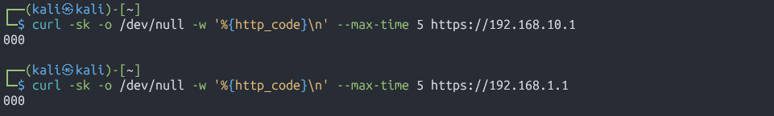

| Test from Kali (Lab) | Before the rule | After the rule |
|---|---|---|
| GUI on Lab gateway address | Not tested | `000` blocked |
| GUI on firewall LAN address | `200` reachable | `000` blocked |

`000` means curl never got a response. The Block rule drops the packets
silently, so the connection just times out.

The rule didn't break anything the Lab legitimately needs. DNS through the
firewall still works from Kali:

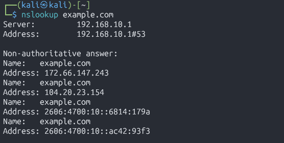

The GUI still opens normally from my LAN PC.

The rule covers **SSH** (port 22) as well as the GUI. SSH also has its own
Listen Interfaces setting under **System → Settings → Administration →
Secure Shell**, worth setting to LAN for the same reason.

## Next steps

Once 26.1 was fully patched, OPNsense offered the next **major** release,
26.7 (1.2 GiB, reboot required):

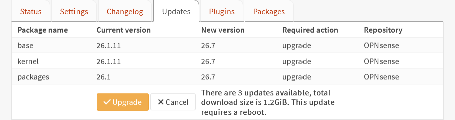

I'm holding that until my automated Git backup is working, so a major
upgrade has a versioned restore point behind it. 26.1.11 already contains the
PHP2Shell fix, so there's no security reason to rush it.

## Lessons

### Sources will conflict, so check the component

The official dashboard announcement listed 26.1.11 as fixed. The main forum
thread only named 26.7.7 and 26.4.2p3. A forum user on the exact version I was
about to install was asking whether the fix had been backported. And 26.1.11
fixed a *different* CVE too, so "26.1.11 fixes a CVE" wasn't proof of anything.

I could have spent an hour reading threads. Instead, the answer was one row in
the update list: `php83` 8.3.30 → 8.3.36. When a vulnerability lives in a
component, the component's version is the source of truth. Next time a CVE
drops, that's the first thing I'll check.

### Patching was easier than I expected

I assumed a 124-package update that included a new kernel would mean a long
outage. It was about **5 minutes** from clicking Update to a working GUI, and
roughly **60 seconds** of actual network downtime during the reboot.

That's the real lesson. My firewall went 65 days without patches, and the
reason wasn't technical. I expected it to be disruptive, so I put it off. Now
that I know what it costs, a regular update window is easy to justify.

## Sources

- [OPNsense forum: PHP2Shell hotfix for 26.7.7 / 26.4.2p3](https://forum.opnsense.org/index.php?topic=53191.0)
- [OPNsense forum: Critical PHP vuln php2shell](https://forum.opnsense.org/index.php?topic=53190.0)
- [OPNsense forum: PHP2Shell security fix for 26.1.x?](https://forum.opnsense.org/index.php?topic=53192.0)
- [BleepingComputer: PHP ships emergency patches for critical PHP2Shell flaws](https://bleepingcomputer.com/news/security/php-ships-emergency-patches-for-critical-php2shell-flaws)
- [CVE-2026-58394 (fixed separately in 26.1.11)](https://www.mend.io/vulnerability-database/CVE-2026-58394/)
